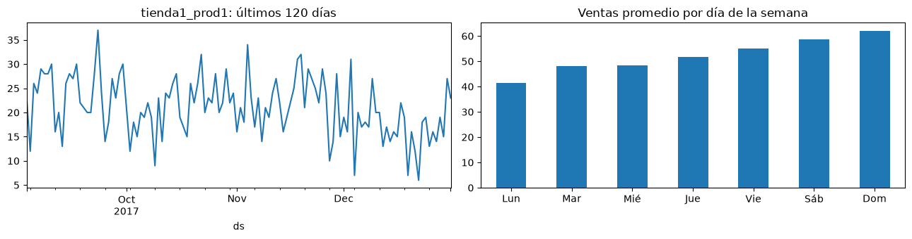
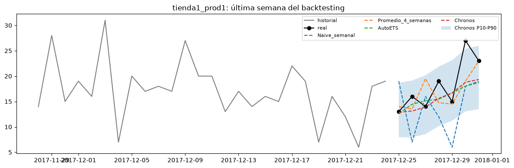
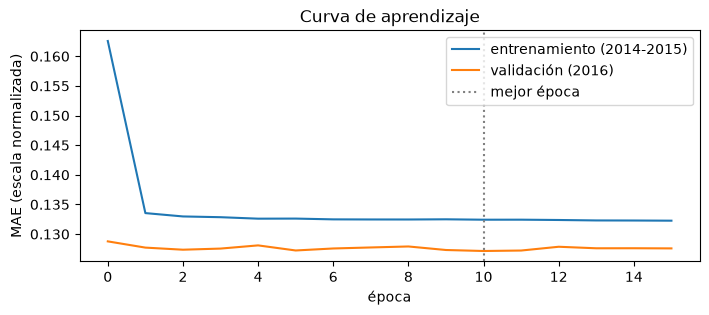
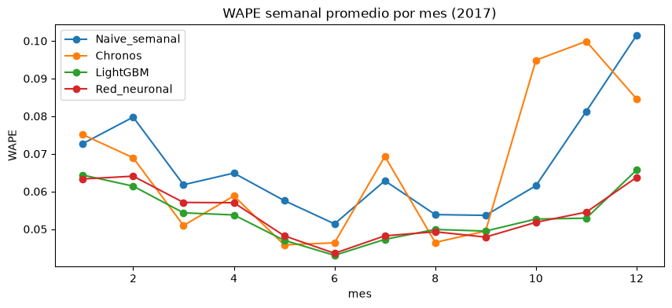
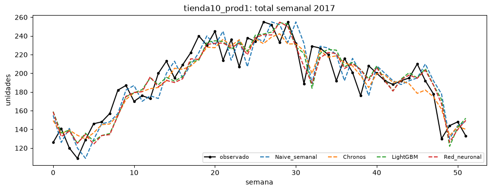

# Pronóstico de consumo de inventario a 7 días

Documentación técnica de los experimentos contenidos en `ml/notebooks/`.

| Notebook | Contenido | Estado |
|---|---|---|
| `01_pronostico_7_dias.ipynb` | Experimento 1: modelos de referencia, evaluados en 4 semanas de diciembre de 2017 | Ejecutado |
| `02_comparacion_2017.ipynb` | Experimento 2: modelos entrenados (LightGBM y MLP), evaluados en las 52 semanas de 2017 | Ejecutado |

**Versión documentada: v0.1** (primer entrenamiento). Los resultados, las figuras y los modelos descritos en este documento corresponden a esta versión:

| Artefacto | Ubicación |
|---|---|
| Figuras | `ml/notebooks/figuras/v0.1/` |
| MLP entrenado | `ml/models/v0.1/red.keras` (versionado en el repositorio) |
| Modelos LightGBM | `ml/models/v0.1/lightgbm_dia1.txt` … `lightgbm_dia7.txt` (excluidos del repositorio por tamaño; se regeneran ejecutando el notebook 02) |

Las versiones posteriores guardarán sus artefactos en carpetas propias (`v0.2/`, …), definidas por la constante `VERSION` del notebook 02.

---

## 1. Objetivo y alcance

Estimar el número de unidades de cada producto que se consumirán en los siguientes 7 días a partir del historial de salidas de inventario.

Ubicación del módulo dentro del sistema:

```
ESP32-S3 (cámara, TinyML)         registro de salidas de productos
        ↓
Base de datos / Home Assistant    almacenamiento del historial
        ↓
Servicio Python (Raspberry Pi)    pronóstico diario a 7 días        ← este módulo
        ↓
Home Assistant (sensores)         consulta por el agente conversacional (Ollama)
```

Los notebooks cubren la selección y validación del modelo. El servicio de producción (`ml/forecast.py`) se desarrollará en una etapa posterior.

---

## 2. Datos

### 2.1 Fuente

Competencia *Store Item Demand Forecasting Challenge* de Kaggle (identificador `demand-forecasting-kernels-only`; "kernels only" indica que la competencia solo admitía envíos generados desde notebooks de Kaggle).

| Archivo | Contenido | Uso |
|---|---|---|
| `train.csv` | Ventas diarias observadas (`date, store, item, sales`), del 2013-01-01 al 2017-12-31 | Único archivo utilizado |
| `test.csv` | 45,000 combinaciones fecha-tienda-producto del 2018-01-01 al 2018-03-31, sin ventas | No utilizado: no incluye valores observados |
| `sample_submission.csv` | Formato de envío a la competencia (valor constante 52) | No utilizado |

### 2.2 Características

- 10 tiendas × 50 productos = 500 series diarias de 1,826 días cada una (913,000 registros).
- Ventas entre 0 y 231 unidades/día (mediana: 47).
- Sin fechas faltantes; el 0.0001% de los días registra venta cero.
- Estacionalidad semanal (mayor venta en fin de semana) y anual (máximo en julio, ~67 unidades/día en promedio; mínimo en enero, ~35).



*Figura 1. Izquierda: ventas diarias de una serie en los últimos 120 días. Derecha: venta media por día de la semana (500 series).*

### 2.3 Justificación

- Corresponde al problema planteado: unidades por producto y por día.
- Es un conjunto externo y de referencia pública. Evaluar con datos generados según reglas propias introduciría un sesgo: el modelo aprendería las reglas del generador.
- **Limitación:** es un conjunto limpio (sin quiebres de stock, huecos ni productos nuevos). Los datos reales presentarán mayor ruido; por ello la metodología de evaluación se diseñó para reutilizarse con datos propios.

### 2.4 Obtención

El archivo se ubica en `ml/data/train.csv` y está excluido del repositorio (`.gitignore`: `*.csv`). Puede descargarse desde la página de la competencia o con `kagglehub`, que requiere cuenta de Kaggle, token de API y aceptación de las reglas de la competencia:

```python
import kagglehub
path = kagglehub.competition_download('demand-forecasting-kernels-only')
```

---

## 3. Metodología de evaluación

### 3.1 Definiciones

- **Serie de tiempo:** ventas diarias de un producto en una tienda.
- **Horizonte (H = 7):** número de días pronosticados.
- **Estacionalidad semanal (`season_length = 7`):** patrón que se repite cada 7 días.
- **Origen o corte:** último día con información disponible al momento de pronosticar.

### 3.2 Backtesting

La evaluación se realiza mediante validación temporal (*backtesting*): en cada corte, el modelo utiliza únicamente los datos anteriores y pronostica los 7 días siguientes, que luego se comparan con los valores observados.

No se emplea una partición aleatoria porque permitiría al modelo usar información posterior a la fecha pronosticada (fuga de información), lo que sobrestima su desempeño. Se utilizan varios cortes para reducir la influencia de semanas atípicas.

### 3.3 Métricas

| Métrica | Definición | Unidad | Propósito |
|---|---|---|---|
| MAE | media de \|ŷ − y\| | unidades/día | Error en unidades, de interpretación directa. Depende del volumen de cada serie. |
| WAPE | Σ\|ŷ − y\| / Σy | % | Error relativo, comparable entre series y conjuntos de datos; pondera por volumen. Se prefiere sobre el MAPE, que se indefine cuando y = 0. |
| Sesgo | Σ(ŷ − y) / Σy | % | Dirección del error: positivo indica sobreestimación (exceso de inventario); negativo, subestimación (quiebre de stock). |
| WAPE semanal | WAPE calculado sobre totales de 7 días | % | Error en la escala de la decisión de reabastecimiento. |
| Cobertura P90 | % de días con y ≤ P90 | % (objetivo ≈ 90%) | Calibración del cuantil superior. |
| Cobertura P10–P90 | % de días con P10 ≤ y ≤ P90 | % (objetivo ≈ 80%) | Calibración del ancho del intervalo. |

### 3.4 Pronóstico probabilístico

Un cuantil Pq es el valor por debajo del cual se espera que quede la demanda con probabilidad q. El P50 corresponde a la mediana; el P90 es el valor que la demanda no supera en el 90% de los casos.

En reabastecimiento, ordenar según el P50 implica quiebre de stock en aproximadamente la mitad de los períodos; ordenar según el P90, en aproximadamente uno de cada diez, a costa de mantener mayor inventario.

---

## 4. Experimento 1: modelos de referencia (notebook 01)

### 4.1 Modelos

| Modelo | Descripción | Justificación |
|---|---|---|
| Naive estacional (`SeasonalNaive`) | ŷ(t) = y(t − 7) | Línea base mínima, sin parámetros. |
| Promedio de 4 semanas (`SeasonalWindowAverage`) | Media de y(t−7), y(t−14), y(t−21) e y(t−28) | Reduce la sensibilidad a semanas atípicas. |
| AutoETS | Suavizado exponencial (error, tendencia y estacionalidad); selecciona automáticamente la configuración de cada serie | Método estadístico estándar. |
| Chronos-Bolt small | Modelo fundacional preentrenado (Amazon, ~48 M parámetros), utilizado *zero-shot*; entrega cuantiles | Alternativa sin entrenamiento; robusta con historial corto. |

Los tres primeros pertenecen a la librería `statsforecast` (Nixtla). Chronos se obtiene de la librería `chronos-forecasting` y sus pesos de Hugging Face (`amazon/chronos-bolt-small`, 183 MB). Todas son de código abierto (licencia Apache 2.0).

Métodos descartados:
- **Croston/TSB:** orientados a demanda intermitente; el conjunto casi no presenta días sin venta.
- **Gradient boosting:** se evalúa en el experimento 2.
- **Ajuste fino (*fine-tuning*) de Chronos:** requiere un volumen considerable de datos reales y GPU.

### 4.2 Configuración

4 cortes semanales (2017-12-03, 2017-12-10, 2017-12-17 y 2017-12-24), horizonte de 7 días y 500 series: 14,000 pronósticos diarios por modelo.

### 4.3 Resultados

Error diario:

| Modelo | MAE (unidades/día) | WAPE | Sesgo |
|---|---|---|---|
| Chronos | 6.31 | 14.2% | +5.2% |
| AutoETS | 7.05 | 15.9% | +8.3% |
| Naive estacional | 8.74 | 19.7% | +5.1% |
| Promedio 4 semanas | 10.63 | 24.0% | +20.1% |

Error sobre el total semanal:

| Modelo | WAPE semanal |
|---|---|
| Chronos | 8.4% |
| Naive estacional | 10.1% |
| AutoETS | 10.9% |
| Promedio 4 semanas | 20.5% |

Calibración del intervalo de Chronos: cobertura P90 de 94.9% y cobertura P10–P90 de 77.1%.



*Figura 2. Última semana evaluada (tienda1_prod1): valores observados, pronóstico de cada modelo e intervalo P10–P90 de Chronos.*

Tiempo de ejecución: 33 minutos en CPU (Windows), atribuibles casi en su totalidad a AutoETS (2,000 ajustes: 500 series × 4 cortes). Chronos generó los pronósticos de las 500 series en segundos.

### 4.4 Discusión

1. Chronos obtiene el menor error en todas las métricas: su MAE es 10% menor que el de AutoETS y 28% menor que el del modelo naive.
2. Todos los modelos presentan sesgo positivo. En el conjunto, la venta media pasa de ~62 unidades/día en las últimas semanas de noviembre a ~44 en diciembre, y los métodos basados en semanas recientes no anticipan esa caída estacional. El promedio de 4 semanas es el más afectado (+20.1%). Chronos utiliza un contexto histórico largo y captura parcialmente la estacionalidad anual.
3. En el total semanal, el modelo naive supera a AutoETS a pesar de tener mayor error diario: el sesgo de AutoETS (+8.3%) no se compensa al agregar los días. Esto justifica evaluar más de una métrica.
4. El intervalo de Chronos está razonablemente calibrado y es ligeramente conservador en el P90, lo cual es preferible para evitar quiebres de stock.

### 4.5 Conclusión

Se selecciona Chronos-Bolt small como modelo de referencia, y el naive estacional se mantiene como respaldo operativo y como control. La evaluación cubre un único mes con cambio estacional; el experimento 2 la extiende a todo 2017.

---

## 5. Experimento 2: modelos entrenados (notebook 02)

### 5.1 Objetivo

Determinar si un modelo entrenado sobre el conjunto de datos supera a Chronos, y si un modelo de tamaño compatible con el ESP32-S3 alcanza una precisión aceptable.

### 5.2 Partición temporal

Se define como origen *t* el último día con información disponible; con los datos hasta *t* se pronostican los días *t*+1 a *t*+7, como ocurrirá en producción.

| Conjunto | Orígenes | Ejemplos (orígenes × 500 series) | Uso |
|---|---|---|---|
| Entrenamiento | diarios, 2014–2015 (697) | 348,500 | Ajuste de parámetros |
| Validación | diarios, 2016 (360) | 180,000 | Parada temprana |
| Prueba | semanales, 2017 (52) | 26,000 | Evaluación final, una sola vez |

- El entrenamiento inicia el 2014-01-27 porque cada origen requiere 28 días de historial reciente y un año adicional para la variable de estacionalidad anual.
- Ningún objetivo de entrenamiento pertenece a 2016 ni ningún objetivo de validación a 2017; el notebook lo verifica con un `assert`.
- Las cuatro últimas semanas de prueba coinciden con los cortes del experimento 1. Como control, el MAE del modelo naive en esas semanas debe ser 8.74; este valor se verificó.
- Se excluyen AutoETS (su tiempo de ejecución sobre 52 semanas sería de varias horas) y el promedio de 4 semanas (último lugar en el experimento 1).

### 5.3 Variables de entrada

Para cada serie y cada origen *t* se construye un vector de 42 variables:

| Variables | Cantidad | Justificación |
|---|---|---|
| Rezagos *t*−27 … *t*, divididos por la escala | 28 | Nivel actual y patrón semanal reciente. |
| Misma semana del año anterior, dividida por la media de los 28 días previos a esa semana | 7 | Incorpora la estacionalidad anual, que no se observa en una ventana de 28 días. |
| Indicadores (*one-hot*) del día de la semana de *t*+1 | 7 | Ubican cada posición del horizonte en el ciclo semanal. |

La **escala** es la media de los últimos 28 días de la serie. La variable objetivo son las ventas de *t*+1 a *t*+7 divididas por la escala, y las predicciones se multiplican por ella para expresarlas en unidades. La normalización permite entrenar un único modelo global sobre series de distinto volumen.

Se excluyen deliberadamente:
- **El identificador del producto:** el modelo aprendería niveles de venta específicos de este conjunto.
- **La fecha calendario** (mes, día del año): el modelo aprendería el calendario de este conjunto. La variable "misma semana del año anterior" obtiene la estacionalidad de la propia serie y es aplicable a cualquier negocio.

Con estas decisiones, el modelo es transferible a otros inventarios.

**Simplificación conocida:** las series con media inferior a 1 unidad/día no se normalizan (escala = 1). Está señalada en el código con `shortcut:` y debe revisarse con datos reales de demanda intermitente.

### 5.4 LightGBM

Modelo de *gradient boosting* sobre árboles de decisión: cada árbol nuevo se ajusta a los errores residuales de los anteriores. Se entrena un modelo por cada día del horizonte (estrategia directa, 7 modelos), guardados en `ml/models/v0.1/lightgbm_dia1.txt` … `lightgbm_dia7.txt`.

| Hiperparámetro | Valor | Función |
|---|---|---|
| `objective` | `l1` | Minimiza el error absoluto; el estimador resultante es la mediana (P50), comparable con Chronos. |
| `learning_rate` | 0.05 | Peso de la corrección aportada por cada árbol. |
| `num_leaves` | 31 | Complejidad máxima de cada árbol. |
| `min_data_in_leaf` | 200 | Mínimo de ejemplos por hoja; limita el sobreajuste. |
| `feature_fraction` | 0.8 | Fracción de variables muestreadas por árbol; limita el sobreajuste. |

- **Parada temprana:** se agregan árboles (máximo 2,000) mientras el error de validación disminuye; el entrenamiento se detiene tras 50 iteraciones sin mejora.
- **Reentrenamiento final:** sobre 2014–2016, con el número de árboles seleccionado.

### 5.5 Red neuronal (MLP)

```
42 entradas → Dense(64, ReLU) → Dense(32, ReLU) → 7 salidas (t+1 … t+7)
```

- **Parámetros:** (42×64 + 64) + (64×32 + 32) + (32×7 + 7) = 5,063. Ocupan aprox. 20 KB en float32 y 5 KB en int8, dentro de la capacidad del ESP32-S3.
- **Selección de arquitectura:** con variables de entrada ya construidas, un perceptrón multicapa es suficiente. Las capas densas tienen soporte completo en TensorFlow Lite Micro; el soporte de capas recurrentes (LSTM) en microcontroladores es limitado.
- **Entrenamiento:** función de pérdida MAE (estima la mediana, por consistencia con LightGBM), optimizador Adam con tasa de aprendizaje 1e-3, lotes de 512 ejemplos y semilla fija (42).
- **Parada temprana:** paciencia de 5 épocas sobre la validación, con un máximo de 100 épocas. Luego se reentrena desde cero sobre 2014–2016 con el número de épocas seleccionado.
- **Diagnóstico:** el notebook grafica la curva de aprendizaje. Un aumento del error de validación mientras disminuye el de entrenamiento indica sobreajuste.

### 5.6 Implementación

Keras se ejecuta sobre PyTorch (`KERAS_BACKEND="torch"`), que ya forma parte del entorno por Chronos; esto evita instalar TensorFlow en esta etapa. El archivo `ml/models/v0.1/red.keras` es independiente del backend, de modo que el notebook 03 podrá cargarlo con TensorFlow para la cuantización a int8. Se verificó que TensorFlow 2.21 es instalable en Python 3.13.

### 5.7 Alcance de esta versión

- LightGBM y la red pronostican solo la mediana. Para obtener el P90 se entrenarían con `objective="quantile"` (LightGBM) o con una función de pérdida *pinball* (red).
- Los hiperparámetros corresponden a valores estándar. Su ajuste, de realizarse, debe hacerse contra la validación de 2016 y nunca contra la prueba de 2017.

### 5.8 Resultados

Ejecución completa sobre las 52 semanas de 2017 y las 500 series (182,000 pronósticos diarios por modelo), en aprox. 10 minutos: Chronos y el MLP en GPU (RTX 3050), LightGBM en CPU. El control de consistencia se cumple: el MAE del modelo naive en diciembre es 8.74, igual que en el experimento 1.

| Modelo | MAE (unidades/día) | WAPE | Sesgo | WAPE semanal | Tamaño |
|---|---|---|---|---|---|
| LightGBM | 6.41 | 10.9% | −0.3% | 5.2% | 8,861 KB |
| MLP | 6.45 | 11.0% | −0.7% | 5.3% | 20 KB (float32) |
| Chronos | 7.01 | 11.9% | −1.3% | 6.5% | 183,000 KB |
| Naive estacional | 8.84 | 15.0% | −0.1% | 6.5% | 0 |

**Entrenamiento.**
- **LightGBM:** la parada temprana seleccionó entre 310 árboles (día 1) y 521 (día 6), con 2,923 en total. El número de árboles crece con el horizonte, lo que es coherente con la mayor dificultad de pronosticar días más lejanos.
- **MLP:** la mejor época fue la 11, y el entrenamiento se detuvo en la 16. En la curva de aprendizaje, el error de entrenamiento desciende en la primera época y se estabiliza en ~0.132; el de validación permanece estable entre 0.127 y 0.129, sin tendencia creciente, por lo que no hay evidencia de sobreajuste.
- El error de validación es menor que el de entrenamiento. La explicación probable es el crecimiento del volumen de ventas (media diaria de 50.1 en 2014 y 52.3 en 2015, frente a 56.6 en 2016): a mayor volumen, menor ruido relativo en la escala normalizada.



*Figura 3. Curva de aprendizaje del MLP: MAE en escala normalizada por época, para entrenamiento (2014–2015) y validación (2016).*

**Error por mes.**
- Los modelos entrenados mantienen un WAPE semanal entre 4.3% y 6.6% durante todo el año.
- El naive estacional aumenta en los cambios de temporada (febrero, y de octubre a diciembre, con un máximo de 10.1% en diciembre).
- Chronos es competitivo entre marzo y septiembre (es el mejor en marzo, mayo y agosto), pero se degrada de octubre a diciembre (9.5%, 10.0% y 8.5%), cuando la venta cae por estacionalidad anual.



*Figura 4. WAPE semanal promedio por mes en 2017, por modelo.*



*Figura 5. Total semanal observado y pronosticado para tienda10_prod1 durante 2017.*

**Discusión.**
1. Los dos modelos entrenados superan a ambas referencias en todas las métricas. Su WAPE semanal (5.2–5.3%) es aprox. 20% menor que el de Chronos y el naive (6.5%).
2. La diferencia entre LightGBM y el MLP es despreciable (0.1 puntos porcentuales en WAPE semanal), pero el MLP ocupa aprox. 440 veces menos memoria (20 KB frente a 8.9 MB). El MLP es el candidato para el ESP32-S3.
3. Chronos supera al naive en el error diario (11.9% frente a 15.0%), pero lo iguala en el total semanal. La ventaja de los modelos entrenados se concentra en los meses de cambio estacional, que anticipan mediante la variable "misma semana del año anterior".
4. Sobre el año completo, el sesgo de todos los modelos es cercano a cero. El sesgo positivo del experimento 1 era propio de diciembre.
5. El experimento 1, limitado a diciembre, favorecía a Chronos; la evaluación anual modifica esa conclusión. Esto confirma la necesidad de evaluar sobre un período que cubra todas las temporadas.
6. Los modelos entrenados aprendieron de la misma distribución que el conjunto de prueba, mientras que Chronos se usa sin entrenamiento. Con datos reales deberán reentrenarse, y requieren al menos un año de historial para la variable anual; Chronos no tiene esa restricción.

**Conclusión.**

| Uso | Modelo |
|---|---|
| ESP32-S3 | MLP, sujeto a la reevaluación tras la cuantización int8 (notebook 03) |
| Raspberry Pi | LightGBM o MLP (desempeño equivalente); se sugiere el MLP para mantener un único modelo en ambos dispositivos |
| Productos con menos de un año de historial | Chronos |
| Control | Naive estacional |

**Limitaciones.**
- Hiperparámetros sin ajustar.
- Pronóstico solo de la mediana.
- Un único conjunto de datos, de carácter limpio.
- No se evaluó la significancia estadística de la diferencia entre LightGBM y el MLP.

---

## 6. Integración y despliegue

### 6.1 Servicio en la Raspberry Pi

Un script (`ml/forecast.py`) ejecutado una vez al día (cron o automatización de Home Assistant) leerá el historial de salidas, generará el pronóstico de los 7 días siguientes y publicará un sensor por producto (por ejemplo, `sensor.pronostico_arroz_7d`) con el P50 y el P90 como atributos, mediante la API REST de Home Assistant o MQTT. El agente conversacional (Ollama) consultará esos sensores.

En el notebook 01, `total_p90` es la suma de los P90 diarios y no el P90 del total semanal. Como los errores diarios se compensan parcialmente, la suma es mayor y constituye una estimación conservadora.

### 6.2 Rol del ESP32-S3

| | Raspberry Pi | ESP32-S3 |
|---|---|---|
| Tipo | Computadora de placa única (Linux) | Microcontrolador |
| Memoria | 2–8 GB | Unos pocos MB |
| Ejecuta Python / Chronos | Sí | No |
| Función en el sistema | Home Assistant, pronóstico, base de datos | Cámara, sensores y control local |

La especificación del proyecto asigna el pronóstico a un servicio Python. Se interpreta que el modelo TinyML del ESP32-S3 corresponde al registro de salidas (detección o conteo de productos), lo cual está pendiente de confirmar con el equipo.

Si se requiere ejecutar el pronóstico en el ESP32-S3, las alternativas son el MLP cuantizado a int8 con TensorFlow Lite Micro (notebook 03) o LightGBM convertido a código C (por ejemplo, con `m2cgen`). En ambos casos, el ESP32 debe almacenar los últimos 28 días de cada producto, y el modelo solo se justifica si supera al naive estacional.

---

## 7. Consideraciones para datos reales

1. **Salidas y demanda:** cuando un producto se agota, las salidas registradas son cero aunque exista demanda. Entrenar con esos registros sesga el modelo hacia la subestimación. Se recomienda registrar el stock diario y excluir los días con stock cero.
2. **Productos nuevos:** las variables de entrada requieren al menos 28 días de historial (y un año para la variable anual). Mientras tanto se utiliza Chronos o el naive estacional.
3. **Feriados y promociones:** el conjunto de Kaggle no los registra. Si el negocio los presenta, deben incorporarse como variables (por ejemplo, con Chronos-2 o LightGBM).
4. **Demanda intermitente:** para productos de venta esporádica deben evaluarse Croston/TSB (`statsforecast.models.CrostonOptimized`) y revisarse la normalización descrita en la sección 5.3.

---

## 8. Reproducibilidad

**Entorno:** Python 3.13, dependencias en `ml/requirements.txt`. Desde la raíz del repositorio:

```powershell
python -m venv .venv
.venv\Scripts\activate
pip install -r ml/requirements.txt
```

**Aceleración por GPU (opcional):** `requirements.txt` instala PyTorch para CPU, que es la configuración de la Raspberry Pi. En un equipo con GPU NVIDIA (driver compatible con CUDA 13.2 o superior) puede reemplazarse por la versión con CUDA:

```powershell
pip install "torch==2.15.0+cu132" --index-url https://download.pytorch.org/whl/cu132 --force-reinstall --no-deps
```

Con esta versión, Chronos y Keras utilizan la GPU automáticamente. LightGBM se ejecuta en CPU, porque la distribución de PyPI no incluye soporte de GPU.

**Ejecución:** abrir el notebook en VS Code, seleccionar el kernel `.venv` y ejecutar *Run All*. La ejecución es local; la única conexión externa es la descarga de los pesos de Chronos desde Hugging Face, que quedan en caché tras la primera ejecución.

| Notebook | Tiempo (Windows; GPU RTX 3050 6 GB) |
|---|---|
| 01 | 33 min en CPU (medido) |
| 02, `PRUEBA_RAPIDA = True` | 3.5 min en CPU (medido) |
| 02, completo | ~10 min con GPU (medido); ~1 h solo con CPU (estimado) |

Inferencia de Chronos para 500 series y una semana (medido): 0.8 s en GPU y 42 s en CPU. El valor en CPU es la referencia para la Raspberry Pi, que no dispone de GPU.

En Windows, `StatsForecast` se configura con `n_jobs=1`, porque la ejecución en paralelo (`n_jobs=-1`) deja procesos bloqueados. En la Raspberry Pi (Linux) puede evaluarse `n_jobs=-1`.

---

## 9. Próximos pasos

1. Notebook 03: cuantización int8 del MLP, reevaluación sobre 2017 y exportación para el firmware. El MLP supera al naive estacional (sección 5.8), condición establecida para este paso.
2. Confirmar con el equipo el rol del ESP32-S3 (sección 6.2).
3. Definir la tabla de salidas en la base de datos, por ejemplo: `salidas(fecha, producto_id, cantidad, stock_restante)`.
4. Implementar el servicio `ml/forecast.py`.
